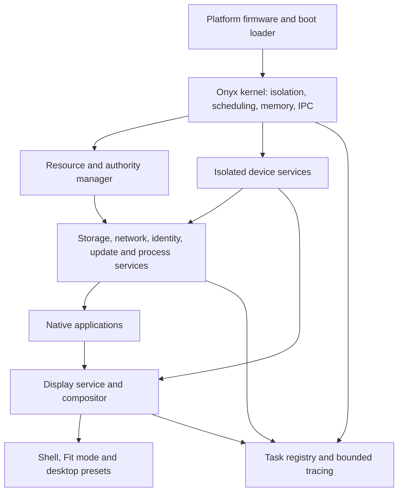

# Architecture proposal

Status: design foundation, not an implemented operating system. Every component below is planned unless a later implementation and evidence record says otherwise. The initial decisions are hypotheses to test, not claims that a particular architecture is inherently fastest or safest.

OnyxOS is an original operating system for ordinary PC hardware, with a shared portable source tree that can later support selected ARM boards and compute servers. Ubuntu and Windows identify the intended PC hardware class. Running their applications, kernels, drivers, or guest operating systems is not a launch requirement. Desktop presets reproduce useful interaction patterns; a preset is not Ubuntu itself.

## System boundaries

The proposed kernel is a small capability-oriented microkernel, with user-space services for policy, protocols and most drivers. It owns address spaces, scheduling, interrupt delivery, primitive memory objects and IPC. Moving a service into the kernel requires an architecture decision documenting measured benefit, a threat-model change, and alternatives. Capability systems associate rights with object references; seL4 provides a useful independently documented example. Onyx does not inherit seL4's implementation, verification, or guarantees. [seL4 capability and resource-management description](https://sel4.systems/About/FAQ.html)

IPC carries fixed-size control messages and explicit capability transfers. Large payloads use bounded shared buffers with defined ownership transitions, cancellation and completion. A zero-copy path is accepted only when lifetime and revocation are correct; copying a small message can be preferable. Resource exhaustion must return a defined error without unchecked allocation or unbounded queues. Priority inheritance or bounded scheduling-context donation must prevent a low-priority server from indefinitely blocking interactive work.

## Subsystem responsibility map

This is the initial coverage inventory. Each row needs a versioned interface, named maintainer, implementation milestone, failure model and test evidence before it becomes supported.

| Area | Responsibility and boundary | Required evidence |
| --- | --- | --- |
| Bootstrap | Image verification, firmware handoff, memory map, initial tables, recovery console | Corrupt-image rejection; reproducible boot traces |
| CPU abstraction | Traps, privilege transitions, atomics, cache and TLB operations, CPU discovery | Per-architecture conformance and fault tests |
| Scheduler | Preemption, priority classes, fairness, deadlines, admission and CPU affinity | Tail latency under CPU saturation; starvation checks |
| Interrupts and time | Interrupt routing, monotonic time, timers, clock calibration | Timer storms, clock changes and multi-core ordering |
| Physical memory | Page ownership, reusable pools, DMA restrictions and NUMA locality | Exhaustion, fragmentation and zero-before-reuse checks |
| Virtual memory | Address spaces, mappings, guard pages, permissions, fault dispatch | Cross-process isolation and mapping lifecycle tests |
| IPC and capabilities | Authenticated object access, delegation, transfer, revocation, quotas | Confused-deputy, stale-handle and denial-of-service tests |
| Process lifecycle | Spawn, exit, signals/events, cancellation, supervision, accounting | Crash/restart loops and orphan cleanup |
| Task observability | Stable IDs, human labels, parentage, privilege, CPU/GPU/I/O usage | Every schedulable task and service visible to authorized tools |
| Device framework | Discovery, binding, hotplug, reset, power and driver isolation | Missing hardware, surprise removal and faulty-device recovery |
| Storage | Block queues, caching, integrity, filesystem, mounts and encryption boundary | Power-loss simulation, crash consistency and corrupt media |
| Networking | Link management, IP, transport, DNS, TLS boundary, firewall and per-app permission | Parser fuzzing, authenticated-transport checks, connection limits and adversarial traffic |
| Display and GPU | Buffers, queues, synchronization, modes, presentation and recovery | Pixel correctness, latency, bandwidth and hung-GPU recovery |
| Input | Keyboard, pointer, touch, focus, remapping, accessibility routing | No focus theft; reliable input during overload |
| Audio and media | Device graph, mixing, timestamped streams, codec isolation | Underruns, bounded buffers and device reconnect |
| Shell and toolkit | Fit mode, standard mode, presets, text, clipboard, drag/drop | Accessible navigation; state preserved across switches |
| Accessibility | Semantic tree, screen-reader access, zoom, keyboard/touch targets | Keyboard-only use and low-vision usability review |
| Identity and policy | Login, session locking, principals, permissions, secrets | Separation between users and applications |
| Packages and updates | Signed manifests, dependencies, atomic activation, rollback | Interrupted update recovery; revoked-key handling |
| Application ABI and SDK | Versioned executable/IPC formats, library boundaries, package identity and compatibility negotiation | Unsupported-version rejection; upgrade compatibility; clean process teardown |
| Power and thermal | Idle states, frequency policy, battery, suspend and resume | Thermal throttling, energy and resume correctness |
| Platform services | ACPI/device tree, RTC, entropy, locale, fonts, Unicode and time zones | Malformed descriptors; entropy readiness; text correctness |
| Developer tools | Compiler, assembler, linker, debugger, symbols, profiler, SDK | Deterministic builds and useful crash attribution |
| Deployment and recovery | Images, installation, diagnostics, rescue and factory reset | Recovery without a functioning graphical shell |
| Compute profile | NUMA placement, topology, isolation, accelerator access, batch jobs | Scaling curves and resource-accounting accuracy |
| Distributed layer | Node discovery, authenticated transport, job orchestration | Partition, retry and node-loss tests; later optional service |

Filesystem formats, network stacks, cryptography, update signing and identity are separate engineering projects. They must not be represented as solved by choosing a kernel or language.

## Memory and execution model

Use explicit ownership and lifetimes in native interfaces. Start with page allocation plus size-class slab pools, bounded per-CPU caches and arenas for short-lived work. All allocations are fallible, chargeable to an owner and covered by quotas. Cross-domain reuse clears sensitive memory. Guard pages, non-executable data, writable-versus-executable separation and checked arithmetic are design requirements, with architecture-specific enforcement verified separately.

Reserve resources for kernel progress, input, recovery and memory-pressure handling. Bound pinned GPU/DMA memory independently from pageable application memory. Reclaim caches before terminating eligible tasks; display the cause and owner. No swapping dependency in the earliest boot target. Later swap, compression, huge pages and compaction require measurements and explicit latency policies. Do not perform unbounded reclamation, filesystem I/O or general-purpose allocation in interrupt handlers or the compositor's deadline path.

The scheduler starts with preemptive fair scheduling plus a bounded interactive class. Deadline/reservation scheduling, CPU isolation and NUMA placement are later extensions with admission control. Background work cannot claim interactive priority by self-labeling. Performance policy must retain thermal limits, battery choices and fairness; maximum useful work is not equivalent to keeping every core busy while idle.

## Language and bootstrap boundary

The destination is a compact native systems language and toolchain built for Onyx, with explicit layout, ownership, checked indexing, typed capabilities, bounded effects and no mandatory garbage collector or large runtime. Machine code is the execution format; assembly is reserved for architectural entry points and operations the language cannot yet express safely. A new language alone does not prove memory safety or improve generated code.

A small audited compiler/assembler bootstrap and existing host tools are initially necessary to create the next stage. Record every bootstrap dependency, version and checksum; keep development utilities outside the target runtime. Specify the language and test malformed programs before self-hosting. Replace dependencies incrementally only after differential compiler tests, reproducibility, code-quality measurements and an independent bootstrap review. The bootstrap and runtime ABI remain distinct so compiler work does not freeze OS experimentation. The [toolchain plan](toolchain.md) defines the minimum T2 native-code baseline required before the first native kernel milestone; a full language and self-hosting are later work.

## Operational contracts

- Every task receives a stable kernel-issued identity before it can run. Names, executable provenance, parent relationship and authority are separate fields; an app cannot spoof trusted identity by choosing a display name.
- Display all authorized system tasks, driver workers and interrupt activity in the task inspector, with aggregates for bounded telemetry. Preserve restricted metadata boundaries between users. Firmware, device firmware and a compromised kernel cannot be made fully transparent by a task list.
- Requests are cancellable and asynchronous where work can block. Completion means the result is ready, not merely queued. Every queue has a limit, owner, deadline or fairness policy, and overflow behavior.
- Shell transitions have zero animation duration and no artificial dwell or launch delay. Processing, device I/O, security checks and display scanout still take real time; show honest readiness states.
- Service restart never silently grants new permissions or exposes stale buffers. Recovery uses versioned handles and a generation number for replaceable objects.
- User data, application state and shell layout survive desktop-preset changes. Persistent state uses versioned schemas and atomic replacement.

## Decisions that remain open

Before committing a production ABI, resolve capability revocation cost, scheduler donation semantics, filesystem choice, the initial real GPU family, graphics command validation, custom-language safety rules, secure update trust roots and the smallest supported RAM profile. Record choices with alternatives and benchmark evidence. No design document can enumerate every future device or failure mode; this inventory is maintained as discoveries become concrete.
