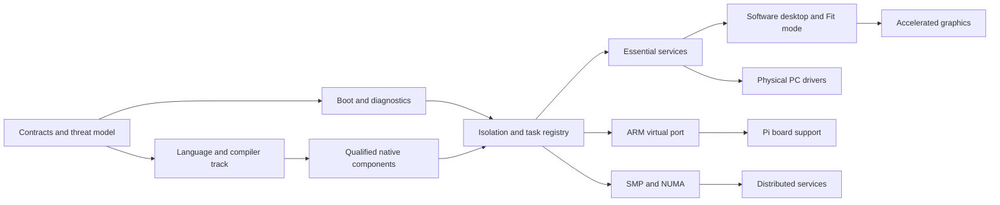

# Roadmap and promotion gates

Status: a staged plan for a new operating system. Repository setup and design material do not mean a bootable, secure, hardware-compatible system exists. Milestones advance on evidence, not dates or feature labels.

## Milestones

| Stage | Deliverable | Exit criteria |
| --- | --- | --- |
| 0 — Contracts | Public repository, requirements, architecture, Fit interaction model, threat model, hardware strategy and benchmark definitions | Cross-document review; unresolved decisions named; prototypes labeled separately from OS implementation |
| 1 — Reproducible boot | T2 native-code baseline, audited entry assembly, x86-64 UEFI loader, serial output, bounded memory-map handoff, traps and timer | Toolchain T2 evidence; rebuildable image; automated QEMU boot/fault tests; no firmware boot-service use after handoff; boot timeline recorded |
| 2 — Isolation substrate | User mode, page ownership, capabilities, IPC, preemptive scheduler, task registry | Cross-address-space isolation; invalid-handle rejection; bounded IPC; all tasks identified; repeatable stress and fault tests |
| 3 — Essential services | Supervision, virtual block/input/network devices, minimal storage and headless shell | Malformed-input tests; service restart; durable storage semantics; minimal-VM boot and memory measurements |
| 4 — Interactive software display | Surface protocol, software compositor, native toolkit, standard/Fit layouts and desktop presets | Fit round-trip preserves state; no artificial delays; keyboard/accessibility paths; geometry and focus tests; measured input and memory baseline |
| 5 — Accelerated virtual display | One verified GPU submission path, explicit synchronization, damage and resource quotas | Actual acceleration demonstrated; output correctness against reference; GPU hang recovery; CPU/GPU timings and deadline distribution published |
| 6 — First physical PC | Named reference machine, storage/USB/network drivers, real display and recovery | Cold boot, reboot, device removal and installation qualified; hardware matrix published; physical input-to-photon measured |
| 7 — ARM portability | AArch64 `virt`, then one specific Raspberry Pi board | Same service interfaces pass on both ISAs; board firmware and drivers qualified on real hardware; low-memory and thermal tests |
| 8 — Daily-use security and reliability | Identity, permission UI, robust filesystem, signed atomic updates, rollback, audio, power management and diagnostics | Threat-model review, fuzzing and fault-injection campaign; interrupted update recovery; documented security limitations; accessible core workflows |
| 9 — Broader hardware and compute | Selected GPUs/laptops, SMP/NUMA tuning, accelerators and compute profile | Per-device qualification; scaling curves; fairness/thermal/power evidence; no unsupported “all hardware” claim |
| 10 — Distributed operation | Optional cluster management and distributed workloads | Authenticated nodes, resource accounting, partition/retry/node-loss tests; explicit scaling limits |

Stages can overlap after their interfaces stabilize. A later stage cannot bypass a dependency's safety or correctness gate. ARM virtual-machine work can begin before broad PC support; physical-board promotion still needs its own evidence. Stage 8 security mechanisms are planned from stage 0 and implemented incrementally, not postponed until after deployment.

## Independent language/toolchain track

1. Specify a small language core: values, layout, ownership, borrowing/alias rules, bounds, effects, errors, concurrency and unsafe escape hatches. Define what remains outside its safety guarantee.
2. Implement a minimal audited stage-0 compiler or translator with pinned host dependencies. Establish parser fuzzing, negative compilation tests and deterministic output.
3. Emit native code for the first architecture and support linking/debugging. Compare correctness and generated-code quality with a trusted reference on representative small programs.
4. Port a noncritical user-space service. Preserve a working fallback while measuring code size, allocation, speed and diagnostics.
5. Expand to selected kernel/driver components only after concurrency, MMIO, volatile access and interrupt safety semantics are explicit and tested.
6. Add AArch64 code generation, cross-target tests and self-hosting. A self-hosted compiler is still part of the trust base; document and independently check its bootstrap provenance.

Rewriting a tool or library is justified by a concrete requirement, measured cost, maintenance benefit or reduced trust surface. Keep a dependency inventory so a custom target runtime is not confused with having no build-time tools, specifications or firmware dependencies.

## Workstream dependencies

The language-to-kernel arrow requires the [toolchain plan's T2 native baseline](toolchain.md) before the first native kernel milestone, not a finished full language or self-hosting compiler. Early firmware/assembly experiments may validate the handoff independently, but do not satisfy that milestone. Keep an explicitly recorded minimal bootstrap boundary so neither workstream claims the other's guarantees prematurely.

## First implementation backlog

- Freeze the initial virtual machine configuration, bootstrap language/assembler, image format and reproducible build procedure.
- Define the boot handoff structure and ownership of every memory region; emit a serial boot timeline.
- Implement traps, a monotonic clock and diagnostic fatal-error handling before multitasking.
- Specify task IDs, capability tables, IPC message layout and allocation failure semantics before publishing an ABI.
- Extend the initial host-side reference models for Fit layout, viewport rounding and reversible state with multi-output and client-lifecycle scenarios; these remain behavior models, not performance evidence for an OS.
- Define the surface lifecycle and buffer synchronization protocol before adding acceleration.
- Select one reference PC and one initial GPU based on documentation, licensing and test access.
- Establish versioned evidence records for test revision, machine metadata, raw results and known failures.

## Release rules

An experimental image lists every supported device and unresolved data-loss/security limitation. A developer preview requires reproducible installation and recovery, plus clear permission and task visibility. A daily-use release requires a complete update path, meaningful security review and sustained real-hardware testing. Terms such as “memory safe,” “fastest,” “secure” and “supports this hardware” must name the tested scope and evidence.

No milestone requires native Ubuntu or Windows application compatibility, binary-driver reuse, or guest virtualization. Onyx running efficiently as a VM guest remains a first-class target. Ubuntu-like desktop presets are shell arrangements; running an existing Ubuntu desktop implementation would be a separate compatibility project with its own dependencies and license review.
